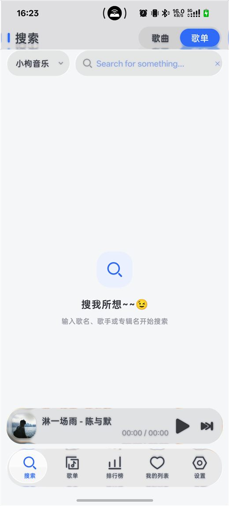
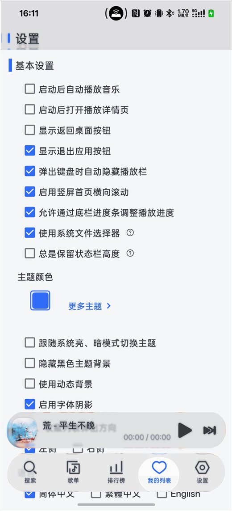
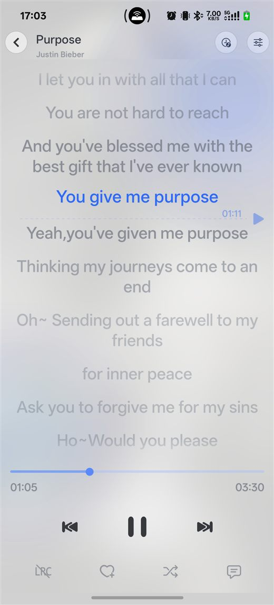
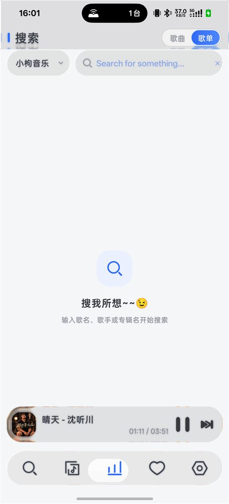

# LX Music · Liquid Glass

在 [lx-music-mobile](https://github.com/lyswhut/lx-music-mobile) 基础上做的一次 **UI 重构分支**：亮色极简（Salt 设计语言）+ 三处**原生液态玻璃**，并把底部导航做成「可按住拖动」的玻璃气泡。

> 这不是官方版本。上游是 lyswhut/lx-music-mobile（Apache-2.0），本仓库只改界面与交互，播放 / 音源 / 数据层保持上游实现。

<p align="center">
  
  
  
  
</p>

## 这个分支做了什么

**1. 主题：Salt（盐白 / 盐黑）**
- 单一主色 `#2F6BF6`，其余靠中性灰阶与留白拉开层级，替换掉上游默认的绿色 Material 风格。
- 设计令牌集中在 `src/theme/design.js`（Spacing / Radius / FontSize / Motion / Salt 色板 / makeShadows），组件只引用令牌，不写魔法数字。

**2. 三处真玻璃（不是半透明白，是原生采样 + 模糊 + 折射）**
- 播放条 `src/components/player/PlayerBar/index.tsx`
- 底部导航 `src/screens/Home/Vertical/components/GlassTabBar.tsx`
- 顶部标题带 `src/screens/Home/Vertical/Header.tsx`
- 实现：`src/components/common/LiquidGlass.tsx` 是对 [QWEA0/Liquid-Glass-Android](https://github.com/QWEA0/Liquid-Glass-Android) 的 RN 封装（原生 view 名 `RCTLiquidGlass`），Kotlin 侧见 `android/app/src/main/java/cn/toside/music/mobile/glass/`。
- 两个关键点：玻璃视图必须**盖在内容之上**才能采样到底下的画面（所以底栏是 `position: absolute`）；`backdropSource` 要绑定到 `android.R.id.content`，否则采样到的是自己。

**3. 底部导航的拖拽气泡**
- 选中项是一枚包住图标+文字的玻璃圆；按住它左右拖，气泡跟手，经过的格子图标放大 1.05 并加重，松手吸附到落点并切页。
- 手势用 `PanResponder`：横向位移 > 8dp 才「抓起来」（否则仍算点击），位置由像素驱动（`posX`），松手 `spring` 吸附。

**4. 下滑收起的小圆播放器**
- 列表下滑时，播放条收进底栏左侧变成圆形封面，播放时封面旋转；点它再展开回完整播放条。
- 状态走模块级订阅 `src/utils/playerBarMode.ts`，避免滚动事件引发整棵树重渲染。

**5. 歌词动效**
- 当前行主色 + 加粗 + `scale 1.04` + 上浮 2dp，`spring` 带轻微过冲；上下行按距离分档变淡（1 / 0.66 / 0.46 / 0.32），不是线性淡出。

## 构建

```bash
npm install                 # 自动执行 scripts/patch-node-modules.js，修补两个 node_modules 兼容问题
npm start                   # Metro

# 另一个终端
cd android
./gradlew assembleRelease   # 需要 JDK 17+ 与 Android SDK；签名见下
```

环境（实测通过）：JDK 21、Android SDK Platform 35 + Build-Tools 35、NDK 26.1、Gradle 8.8（wrapper 自带）、Node 26。

**签名**：`android/app/build.gradle` 在配置阶段就会读 `android/keystore.properties`，缺文件会直接构建失败。自用请指向 debug keystore：

```properties
storeFile=debug.keystore
storePassword=android
keyAlias=androiddebugkey
keyPassword=android
```

**与正式版共存**：`./gradlew assembleRelease "-PappIdSuffix=.dev"` 得到 `cn.toside.music.mobile.dev`，可与官方包同时安装。

## 音源

仓库**不附带任何音源脚本**。`src/dev/emSourceScript.ts` 是空占位（说明见文件注释），也可以在 App 里「设置 → 自定义源 → 导入」手动加载。

## 已知问题

- 玻璃在 **API 33+** 最完整（AGSL 单 pass 透镜）；API 24–32 走经典管线，小尺寸视图上模糊偏弱，表现是「半透明但不太糊」。
- PagerView 横滑时搜索框上的玻璃会短暂丢失采样，回弹后恢复；已用半透明白/黑垫底兜底。
- 横屏歌词页仍是上游旧样式，竖屏这套动效尚未同步。
- 原生 `Alert.alert`（如首次启动的提示框）是系统样式，不跟主题。

## 许可与致谢

- 基于 [lyswhut/lx-music-mobile](https://github.com/lyswhut/lx-music-mobile)，遵循 **Apache-2.0**（见 `LICENSE`），本仓库的修改同样以 Apache-2.0 发布。
- 液态玻璃封装自 [QWEA0/Liquid-Glass-Android](https://github.com/QWEA0/Liquid-Glass-Android)。
- 设计语言参考 [Moriafly/SaltUI](https://github.com/Moriafly/SaltUI)、Apple HIG 与 Material 3。
- 本项目仅供技术学习与个人使用，不提供任何音频内容；数据来自各平台公开接口，请支持正版。
